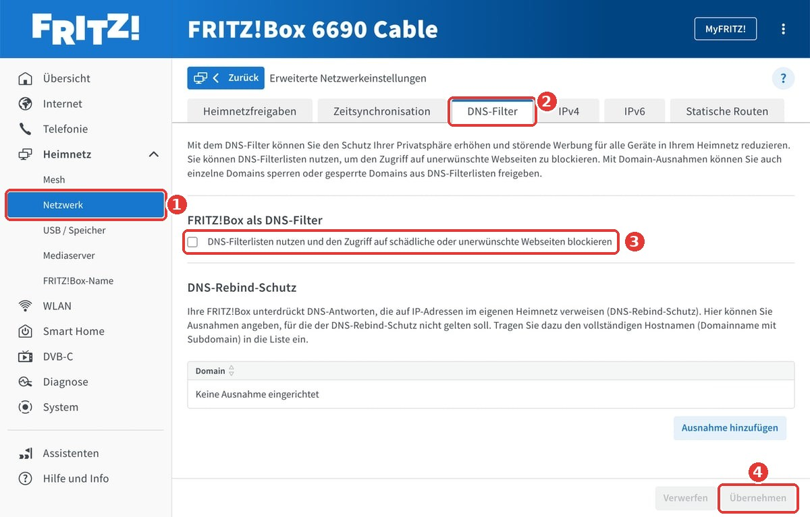
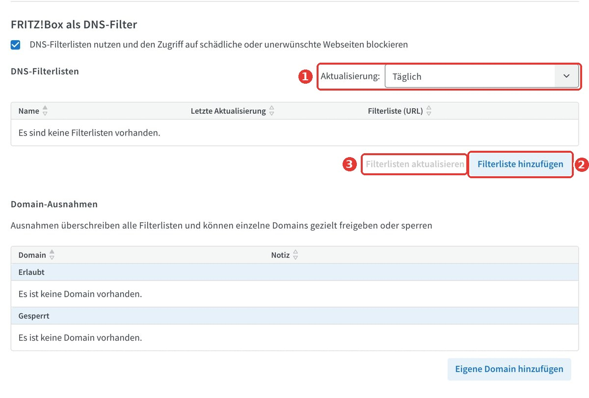
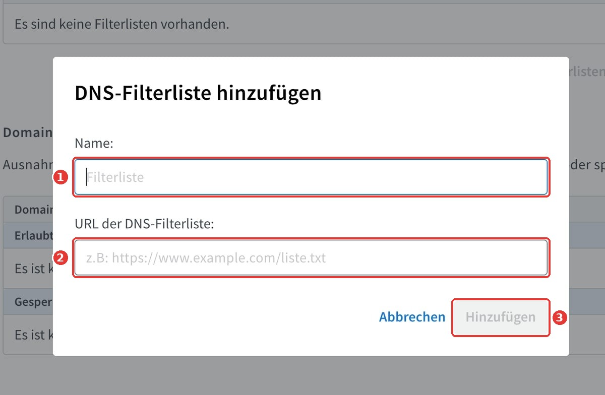
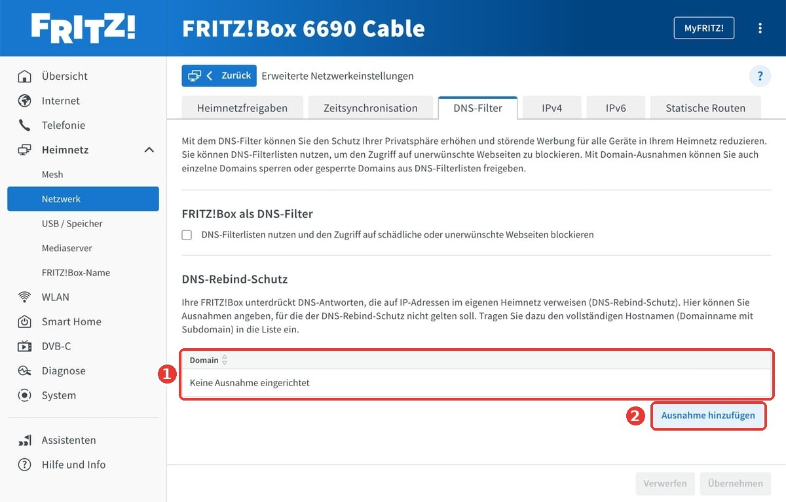
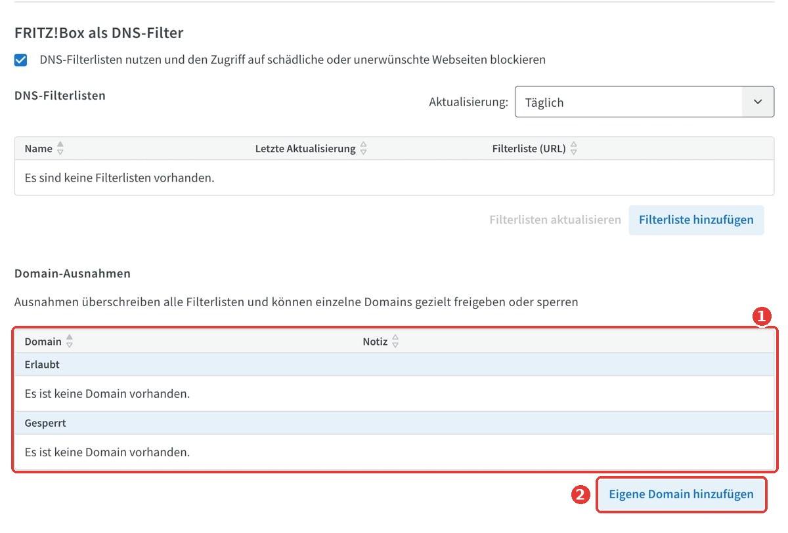

# FRITZ!Box DNS Filter without a Raspberry Pi

[Deutsch](README.md) | **English**

[](#2-requirements)
[](#)
[](https://github.com/hagezi/dns-blocklists)
[](LICENSE-docs)
[](LICENSE)

Network-wide blocking of ads, trackers, phishing and malware domains using the **DNS filter** built into **FRITZ!OS 8.40 (Lab)** and **FRITZ!OS 8.50**. No additional hardware such as a Raspberry Pi, no containers and no paid services are required.

The blocklists used are the freely available lists from [hagezi/dns-blocklists](https://github.com/hagezi/dns-blocklists). The project explicitly lists the FRITZ!Box as a supported system in its format overview.

> [!IMPORTANT]
> This project is independent documentation. It is not affiliated with FRITZ! GmbH (formerly AVM) or with the hagezi/dns-blocklists project. FRITZ!, FRITZ!Box and FRITZ!OS are trademarks of FRITZ! GmbH.
> This is not legal advice. Changes to the router configuration are made at your own risk. Create a backup before making any change.

> [!NOTE]
> The screenshots were taken on a **FRITZ!Box 6690 Cable** with the user interface set to **German**. Red numbers mark the order of the steps. The tables below each screenshot list the German label together with the English label used in the English interface. Menu items and labels may differ on other models and FRITZ!OS versions.

As of: 2026-10-24

---

## Contents

1. [How it works](#1-how-it-works)
2. [Requirements](#2-requirements)
3. [Step 1: Back up the configuration](#3-step-1-back-up-the-configuration)
4. [Step 2: Update FRITZ!OS](#4-step-2-update-fritzos)
5. [Step 3: Choose a filter list](#5-step-3-choose-a-filter-list)
6. [Step 4: Set up the DNS filter](#6-step-4-set-up-the-dns-filter)
7. [Step 5: Check the FRITZ!Box DNS configuration](#7-step-5-check-the-fritzbox-dns-configuration)
8. [Step 6: Test](#8-step-6-test)
9. [Step 7: Check end devices](#9-step-7-check-end-devices)
10. [Step 8: Maintain domain exceptions](#10-step-8-maintain-domain-exceptions)
11. [Step 9: Final backup](#11-step-9-final-backup)
12. [Alternative for models without a DNS filter](#12-alternative-for-models-without-a-dns-filter)
13. [Troubleshooting](#13-troubleshooting)
14. [Legal notes](#14-legal-notes)
15. [Limitations and comparison](#15-limitations-and-comparison)
16. [FAQ](#16-faq)
17. [Project structure](#17-project-structure)
18. [Acknowledgements and sources](#18-acknowledgements-and-sources)
19. [License](#19-license)

### Summary

```text
1. System > Backup > Save                              create a password-protected backup
2. System > Update                                     install FRITZ!OS 8.50 (or 8.40 Lab)
3. Home Network > Network > Network Settings
   > Advanced Network Settings > tab DNS Filter
4. Enable "Use DNS filter lists ..." > Apply
5. Add filter list:
     Name: HaGeZi Multi NORMAL
     URL:  https://cdn.jsdelivr.net/gh/hagezi/dns-blocklists@latest/wildcard/multi-onlydomains.txt
   Update interval: Daily > Apply > Update filter lists
6. Tab IPv4: Local DNS server = address of the FRITZ!Box
7. nslookup <domain from the list>                     expected: Server fritz.box, Address 0.0.0.0
```

---

## 1. How it works

### 1.1 DNS

Devices on the internet are addressed by IP addresses. The Domain Name System (DNS) translates names such as `wikipedia.org` into these addresses. Before a device loads a web page, an ad banner or a tracker, it sends a DNS query.

```bash
nslookup wikipedia.org
```

```text
Server:   fritz.box
Address:  192.168.178.1

Name:     wikipedia.org
Address:  185.15.59.224
```

The first two lines show the DNS server that was queried. By default this is the FRITZ!Box, because it announces its own address as the DNS server to all devices via DHCP.

### 1.2 The DNS filter

```text
 Device                       FRITZ!Box                              Result
 ------                       ---------                              ------
 "What is the IP of    --->   Domain on the blocklist?
  ads.example.com?"              |
                                 +-- yes --> answer 0.0.0.0      --> content is not loaded
                                 |
                                 +-- no  --> upstream DNS        --> regular answer, page loads
```

The FRITZ!Box checks every incoming DNS query against the configured blocklists. If the domain is on the list, the box answers with `0.0.0.0` and the device receives no valid target address. Otherwise the query is forwarded to the upstream DNS server and answered normally.

### 1.3 Characteristics

| Characteristic | Description |
|---|---|
| Network-wide | Applies to every device that uses the FRITZ!Box as DNS server, including smart TVs, game consoles and apps |
| No software on devices | Filtering takes place centrally in the router |
| Guest network | According to the FRITZ! changelog, DNS queries from both home and guest network are filtered |
| Privacy-friendly | The box does not keep a query log |
| Security | Known phishing, malware and scam domains are blocked as well |

Technical limitations are described in [section 15](#15-limitations-and-comparison).

---

## 2. Requirements

### 2.1 Checklist

- [ ] A FRITZ!Box from the model list in 2.2
- [ ] FRITZ!OS 8.50 or FRITZ!OS 8.40 Lab
- [ ] A computer with a browser, ideally connected via LAN cable
- [ ] The password for the FRITZ!Box user interface
- [ ] About 20 minutes, including a few minutes without internet (restart)

### 2.2 Supported models

Lab series 8.4x according to trade press and FRITZ! Lab:

| Connection | Models |
|---|---|
| DSL | 7690, 7630, 7590 AX, 7590, 7530 AX |
| Fibre | 5690 Pro, 5690 XGS, 5690, 5590 Fiber |
| Cable | 6690 Cable, 6670 Cable, 6660 Cable |
| Without modem | 4690, 4630, 4050 |
| Mobile | 6850 5G, 6850 5G v2, 6850 4G, 6850 LTE |

The authoritative source is what **System > Update** offers, or the *FRITZ! Lab* page on fritz.com. For older models such as 7490, 7530 (non-AX) or 6490 see [section 12](#12-alternative-for-models-without-a-dns-filter).

### 2.3 Determine model and version

1. Open `http://fritz.box` or `http://192.168.178.1` in a browser and log in.
2. The **Overview** page shows the model and FRITZ!OS version.
3. Missing menu items appear when the view is set to **Advanced**.

---

## 3. Step 1: Back up the configuration

The backup file contains the complete configuration: internet credentials, telephony, Wi-Fi keys, port forwarding, VPN, smart home and user accounts.

**Menu:** `System > Backup > tab Save`

1. Set and confirm a password for the backup file. Without a password, credentials are not included.
2. Click **Save** and confirm on the device if prompted.
3. Store the file with the extension `.export`. If the browser blocks the download, choose **Keep**.

Recommended storage:

```text
FRITZBox-6690_before-update_2026-10-24.export     copy 1: local
                                                  copy 2: external drive or encrypted storage
Password                                          separate from the file, e.g. in a password manager
```

> [!CAUTION]
> Backup files contain credentials. They must never be committed to a Git repository. The included [`.gitignore`](.gitignore) excludes `*.export`.

**Restore:** `System > Backup > tab Restore`, select the file, enter the password, optionally select individual areas. A backup from a newer FRITZ!OS version may not be fully restorable on an older version. A second backup is therefore created in [step 9](#11-step-9-final-backup).

---

## 4. Step 2: Update FRITZ!OS

### 4.1 Regular update to 8.50 (recommended)

1. Open `System > Update > tab FRITZ!OS Version`.
2. Click **Check for new FRITZ!OS**.
3. If 8.50 or later is offered, choose **Start update**.
4. After the restart, check the version on the **Overview** page.

FRITZ!OS 8.50 has been rolled out gradually since 2026-09-30, starting with the 7690 and followed by further models over the subsequent weeks. If 8.50 is not yet available, the Lab version can be used.

### 4.2 Install the Lab version 8.40

Lab versions are pre-release builds from the manufacturer. They may contain bugs, but returning to the release version is supported. Downloading the Lab version implies acceptance of the FRITZ! Lab terms of use.

> [!WARNING]
> If you depend on stable internet or landline telephony (remote work, emergency alarm systems, emergency calls), wait for the regular update.

1. The current release version must be installed on the box.
2. Open the **FRITZ! Lab** page on fritz.com and download the Lab version for your model.
3. Extract the ZIP archive. It contains a file with the extension `.image`.

   ```bash
   unzip FRITZ.Box_6690_Cable-Labor-*.zip -d fritz-lab
   ls fritz-lab/*.image
   ```

4. Open `System > Update > tab FRITZ!OS File`.
5. Select the `.image` file and click **Start update**. Do not interrupt the power supply during the update.

After the restart the overview shows a version `8.40-xxxxxx` marked as *Lab*.

### 4.3 Returning to the release version

`System > Update > tab FRITZ!OS Version` offers the switch back to the release version. Other settings are usually retained. Otherwise restore the backup from step 1.

---

## 5. Step 3: Choose a filter list

### 5.1 Source: hagezi/dns-blocklists

| | |
|---|---|
| Project | [hagezi/dns-blocklists](https://github.com/hagezi/dns-blocklists) |
| License | GPL-3.0 |
| Report false positives | [Issues](https://github.com/hagezi/dns-blocklists/issues) |
| Update frequency | several times a day, validity 8 hours according to the list header |
| FRITZ!Box format | *Wildcard Domains*, FRITZ!OS 8.40 or newer according to the project |

### 5.2 URL structure and file format

```text
https://cdn.jsdelivr.net/gh/  hagezi/dns-blocklists  @latest/  wildcard/  multi  -onlydomains.txt
|--------------------------|  |-------------------|  |------|  |-------|  |---|  |--------------|
 CDN (jsDelivr)               GitHub repository      version   format     level  file suffix
```

The lists are published in several formats. The FRITZ!Box reliably processes the **Wildcard Domains** format: one domain per line, comments start with `#`. An entry blocks the domain including all subdomains.

| Format | Path | Example content | FRITZ!Box |
|---|---|---|---|
| Adblock | `adblock/multi.txt` | `\|\|ads.example.com^` | not suitable |
| Hosts | `hosts/multi.txt` | `0.0.0.0 ads.example.com` | not suitable |
| **Wildcard Domains** | `wildcard/multi-onlydomains.txt` | `ads.example.com` | **suitable** |

A suitable URL is located in the `/wildcard/` directory and ends with `-onlydomains.txt`. The URLs use the jsDelivr CDN. It is more reliable than `raw.githubusercontent.com`, which occasionally throttles requests. Further mirrors and a link generator are documented in the project.

### 5.3 List levels

Choose exactly one main list. Higher levels include the lower ones.

| List | Entries (approx.) | Content | Risk of false positives | Use case |
|---|---:|---|---|---|
| Light | 70,000 | ads, trackers, telemetry | very low | households without technical support |
| **Normal** | 172,000 | plus phishing, malware, scams, cryptojacking | low | **recommended starting point** |
| Pro | 209,000 | extended | medium | recommended by the project, after a settling-in period |
| Pro++ | 223,000 | more aggressive | increased | when exceptions are actively maintained |
| Ultimate | 247,000 | maximum | high | not recommended for network-wide use |

Figures as published by the project (2026-10-24). They change with every build.

```text
Light:   https://cdn.jsdelivr.net/gh/hagezi/dns-blocklists@latest/wildcard/light-onlydomains.txt
Normal:  https://cdn.jsdelivr.net/gh/hagezi/dns-blocklists@latest/wildcard/multi-onlydomains.txt
Pro:     https://cdn.jsdelivr.net/gh/hagezi/dns-blocklists@latest/wildcard/pro-onlydomains.txt
Pro++:   https://cdn.jsdelivr.net/gh/hagezi/dns-blocklists@latest/wildcard/pro.plus-onlydomains.txt
```

### 5.4 Supplementary lists

Supplementary lists are added as separate entries next to the main list.

| List | Purpose | Note |
|---|---|---|
| TIF mini | phishing, malware, scams | The full TIF list has about 2 million entries and is too large for most devices |
| Fake | fake shops, subscription traps | small |
| Pop-Up Ads | pop-up advertising | small |
| NoSafeSearch | blocks search engines without SafeSearch | for households with children |

```text
TIF mini:      https://cdn.jsdelivr.net/gh/hagezi/dns-blocklists@latest/wildcard/tif.mini-onlydomains.txt
Fake:          https://cdn.jsdelivr.net/gh/hagezi/dns-blocklists@latest/wildcard/fake-onlydomains.txt
Pop-Up Ads:    https://cdn.jsdelivr.net/gh/hagezi/dns-blocklists@latest/wildcard/popupads-onlydomains.txt
NoSafeSearch:  https://cdn.jsdelivr.net/gh/hagezi/dns-blocklists@latest/wildcard/nosafesearch-onlydomains.txt
```

> [!WARNING]
> The memory of the FRITZ!Box is limited. If an insufficient-memory error appears, choose a smaller main list or remove a supplementary list.

### 5.5 Validate a list before adding it

```bash
chmod +x scripts/check-list.sh
./scripts/check-list.sh --lang en https://cdn.jsdelivr.net/gh/hagezi/dns-blocklists@latest/wildcard/multi-onlydomains.txt
```

```text
Checking: https://cdn.jsdelivr.net/gh/hagezi/dns-blocklists@latest/wildcard/multi-onlydomains.txt
[ OK ] reachable, 3.3M, 172193 entries
[ OK ] Format: one domain per line, suitable for the FRITZ!Box.

List header:
# Title: HaGeZi's Multi NORMAL - all-round protection
# Homepage: https://github.com/hagezi/dns-blocklists
# License: https://github.com/hagezi/dns-blocklists/blob/main/LICENSE
# Expires: 8 hours
# Last modified: 24 Oct 2026 08:58 UTC
# Number of entries: 172193
```

The script warns about Adblock or hosts format, very large lists and the use of `raw.githubusercontent.com`.

---

## 6. Step 4: Set up the DNS filter

### 6.1 Enable the DNS filter

**Menu:** `Home Network > Network > Network Settings > Advanced Network Settings > tab DNS Filter`



| No. | German label | English label | Action |
|---|---|---|---|
| 1 | Heimnetz > Netzwerk | Home Network > Network | Open the menu. In the *Network Settings* tab, scroll to the bottom and open **Advanced Network Settings**. |
| 2 | DNS-Filter | DNS Filter | Select the tab |
| 3 | DNS-Filterlisten nutzen und den Zugriff auf schädliche oder unerwünschte Webseiten blockieren | Use DNS filter lists and block access to harmful or unwanted websites | Enable the option under *FRITZ!Box as DNS filter* |
| 4 | Übernehmen | Apply | Save. The sections *DNS filter lists* and *Domain exceptions* then appear. |

If the *DNS Filter* tab does not appear, reload the page, set the view to *Advanced* and check the FRITZ!OS version.

### 6.2 Manage filter lists

After activation the tab shows the filter lists and the domain exceptions.



| No. | German label | English label | Purpose |
|---|---|---|---|
| 1 | Aktualisierung: Täglich | Update: Daily | Interval for automatic download of the lists. Recommended: **Daily**. |
| 2 | Filterliste hinzufügen | Add filter list | Opens the dialog described in 6.3 |
| 3 | Filterlisten aktualisieren | Update filter lists | Reloads all configured lists immediately. Enabled as soon as at least one list exists. |

The table shows the name, the time of the last update and the URL of each list. The *Last update* column indicates whether the download works.

### 6.3 Add a filter list



| No. | German label | English label | Value |
|---|---|---|---|
| 1 | Name | Name | `HaGeZi Multi NORMAL` |
| 2 | URL der DNS-Filterliste | URL of the DNS filter list | `https://cdn.jsdelivr.net/gh/hagezi/dns-blocklists@latest/wildcard/multi-onlydomains.txt` |
| 3 | Hinzufügen | Add | Enabled once both fields are filled in |

Then click **Apply** and **Update filter lists**. After about one minute a timestamp appears in the *Last update* column.

### 6.4 Updates

The project rebuilds the lists several times a day. With *Update: Daily* the FRITZ!Box downloads the lists once a day. A manual download is possible at any time via **Update filter lists**.

Recommendation: enable a single list first and observe it for a few days. If problems occur, the cause can then be identified unambiguously.

---

## 7. Step 5: Check the FRITZ!Box DNS configuration

The DNS filter only applies to queries that reach the FRITZ!Box. Several settings in the FRITZ!Box relate to DNS. They are often confused, especially after running a Pi-hole or after manual changes.

### 7.1 Overview

```text
 Device ---> [1] Local DNS server ---> [2] DNS filter ---> [3] Upstream DNS ---> Internet
             which DNS server do        is the domain       whom does the box
             devices receive?           on the blocklist?   ask for all others?
```

Unless stated otherwise, all paths start with `Home Network > Network > Network Settings > Advanced Network Settings`.

| No. | Setting | Location | Default | Requirement for the DNS filter |
|---|---|---|---|---|
| 1 | Local DNS server (IPv4) | tab **IPv4** | address of the FRITZ!Box, e.g. `192.168.178.1` | **must** be the FRITZ!Box |
| 1 | DNSv6 server in the home network | tab **IPv6** | FRITZ!Box announces itself | **must** be the FRITZ!Box |
| 2 | DNS filter | tab **DNS Filter** | disabled | enabled, list added |
| | DNS rebind protection | tab **DNS Filter** | active, no exception | no change required |
| 3 | Upstream DNS | `Internet > Account Information > tab DNS Server` | assigned by the provider | free choice |

### 7.2 Local DNS server (IPv4)

When connecting, every device receives an IP address and the address of a DNS server via DHCP. That DNS address is configured here.

**Menu:** `Home Network > Network > Network Settings > Advanced Network Settings > tab IPv4`

| Field | Default | Meaning |
|---|---|---|
| IPv4 address | `192.168.178.1` | address of the FRITZ!Box in the home network |
| Subnet mask | `255.255.255.0` | size of the home network |
| Enable DHCP server | enabled | the box assigns addresses and DNS server to devices |
| Address range | `192.168.178.20` to `192.168.178.200` | range for automatically assigned addresses |
| **Local DNS server** | address of the FRITZ!Box | DNS server that devices receive |

| Value in *Local DNS server* | Result |
|---|---|
| address of the FRITZ!Box (same as *IPv4 address*) | correct, all queries reach the DNS filter |
| address of a Pi-hole or AdGuard Home | queries go to that device, the FRITZ!Box filter has no effect |
| public server such as `8.8.8.8` or `1.1.1.1` | queries go directly to the internet, no filtering |

**Restoring the default**

1. Enter the IPv4 address of the FRITZ!Box in *Local DNS server*.
2. Click **Apply**.
3. Devices pick up the setting at the next DHCP renewal. To force it immediately:

```powershell
# Windows (Command Prompt or PowerShell as administrator)
ipconfig /release
ipconfig /renew
ipconfig /flushdns
```

```bash
# macOS (interface en0 = Wi-Fi on most models)
sudo ipconfig set en0 DHCP
sudo dscacheutil -flushcache; sudo killall -HUP mDNSResponder

# Linux with NetworkManager
nmcli connection down "<connection name>" && nmcli connection up "<connection name>"
```

Smartphones, smart TVs and other devices pick up the value after disconnecting from and reconnecting to the Wi-Fi.

**Migrating from Pi-hole or AdGuard Home**

1. Reset the local DNS server to the FRITZ!Box as described above.
2. Check under `Internet > Account Information > tab DNS Server` whether the Pi-hole is configured as upstream, and if so revert to the DNS servers assigned by the provider.
3. Check the IPv6 settings as described in 7.3.
4. Only shut down the Pi-hole once the test from step 6 succeeds.

### 7.3 DNSv6 server in the home network (IPv6)

IPv6-capable devices also receive their DNS server via Router Advertisement or DHCPv6. If a different server is announced here, IPv6 queries can bypass the FRITZ!Box.

**Menu:** `Home Network > Network > Network Settings > Advanced Network Settings > tab IPv6`

| Field | Target value | Meaning |
|---|---|---|
| Unique Local Addresses (ULA) | default or *Always assign ULA* | stable local IPv6 address under which the box is reachable as DNS server |
| Router Advertisement enabled in the LAN | enabled | the box announces itself as IPv6 router |
| Also announce DNSv6 server via Router Advertisement (RFC 5006) | enabled | devices without DHCPv6, e.g. Android, receive the DNS server this way |
| Local DNSv6 server | IPv6 address of the FRITZ!Box (default) | DNS server announced to devices |
| DHCPv6 server in the home network | enabled, at least assign DNS server | devices using DHCPv6, e.g. Windows, receive the DNS server |

Exact labels and available options depend on model, connection type and FRITZ!OS version. What matters is that only the FRITZ!Box is announced as DNSv6 server.

**Verification on the device**

```powershell
# Windows
Get-DnsClientServerAddress | Where-Object ServerAddresses |
  Format-Table InterfaceAlias, AddressFamily, ServerAddresses
```

```bash
# macOS
scutil --dns | grep nameserver | sort -u

# Linux (systemd-resolved)
resolvectl status | grep -A3 "DNS Servers"
```

Only the IPv4 address of the FRITZ!Box and its IPv6 addresses (often starting with `fd00:` or `fe80:`) should be listed.

### 7.4 Upstream DNS

Domains that are not on the blocklist are resolved by the FRITZ!Box via the upstream DNS. By default this is the provider's server, and queries are transmitted unencrypted.

**Menu:** `Internet > Account Information > tab DNS Server`

**Option A: Default**

Use the DNSv4 and DNSv6 servers assigned by the provider. No further settings.

**Option B: Encrypted with DNS over TLS**

| Field | Example value (Mullvad DNS, unfiltered) | Meaning |
|---|---|---|
| Use other DNSv4 servers | preferred and alternative `194.242.2.2` | IPv4 address of the resolver |
| Use other DNSv6 servers | `2a07:e340::2` | IPv6 address of the resolver. Without it, IPv6 queries continue to go to the provider. |
| Encrypted name resolution on the internet (DNS over TLS) | enabled | encrypts queries via TCP port 853 |
| Enforce certificate check | enabled | connect only with a valid certificate |
| Fallback to unencrypted name resolution | disabled | no unencrypted fallback if the resolver fails. Higher confidentiality, lower availability. |
| Resolver names of the DNS servers | `dns.mullvad.net` | host name used for certificate validation |

Finally click **Apply**.

> [!NOTE]
> Mullvad's addresses only work encrypted (DoT or DoH), not via classic DNS on port 53. DNS over TLS must therefore be enabled.

With an active local DNS filter, an **unfiltered** upstream is recommended. If two instances filter, the cause of false positives is hard to determine.

### 7.5 DNS rebind protection

DNS rebind protection suppresses DNS answers that point to IP addresses in your own home network. It protects against attacks in which a website accesses devices in the home network via manipulated DNS answers. It is located in the same tab as the DNS filter.

**Menu:** `Home Network > Network > Network Settings > Advanced Network Settings > tab DNS Filter > DNS Rebind Protection`



| No. | German label | English label | Meaning |
|---|---|---|---|
| 1 | Domain | Domain | configured exceptions. Default: none |
| 2 | Ausnahme hinzufügen | Add exception | add a new exception. The full host name (domain name with subdomain) is required, e.g. `nas.example.org`. |

**No change** is required here for the DNS filter. Exceptions are only needed if your own public domains should point to devices in the home network, for example a NAS with its own domain or a DynDNS name used for local access.

### 7.6 Checklist

- [ ] Tab IPv4: local DNS server is the address of the FRITZ!Box
- [ ] Tab IPv6: only the FRITZ!Box is announced as DNSv6 server
- [ ] Tab DNS Filter: option enabled, a list from `/wildcard/...-onlydomains.txt` added, *Last update* shows a timestamp
- [ ] Upstream DNS is the provider default or an unfiltered DoT resolver with IPv4 and IPv6 address
- [ ] DNS rebind protection unchanged, unless own domains are used in the home network
- [ ] End devices do not use their own encrypted DNS ([step 7](#9-step-7-check-end-devices))
- [ ] Test successful ([step 6](#8-step-6-test))

---

## 8. Step 6: Test

The FRITZ!Box does not display statistics. Functionality is therefore verified with a DNS query.

### 8.1 Manual test

1. Open the list URL in a browser and note the first domain after the comment lines. A fixed test domain is deliberately not given because the list changes constantly.
2. Run the query. On Windows in the Command Prompt, on macOS and Linux in a terminal:

```bash
nslookup <test-domain>
nslookup wikipedia.org
```

Expected output:

```text
Server:   fritz.box                   <- the device queries the FRITZ!Box
Address:  192.168.178.1

Name:     <test-domain>
Address:  0.0.0.0                     <- domain is blocked

Server:   fritz.box
Address:  192.168.178.1

Name:     wikipedia.org
Address:  185.15.59.224               <- cross-check: regular domain is resolved
```

| Output | Assessment |
|---|---|
| `Server: fritz.box` or `192.168.178.1` | correct, the device queries the FRITZ!Box |
| another server address, e.g. `8.8.8.8` | the device bypasses the FRITZ!Box, see [step 7](#9-step-7-check-end-devices) |
| `Address: 0.0.0.0`, `::` or no address | domain is blocked |
| regular IP address for the test domain | list not yet active: check *Apply*, *Update filter lists* and *Last update* |

The FRITZ!Box can be queried directly, independent of device settings:

```bash
nslookup <test-domain> 192.168.178.1
```

If this query returns `0.0.0.0` but the query without a server does not, the filter works correctly and the device uses a different DNS server.

### 8.2 Automated test

The scripts download the list, check the first entries against the FRITZ!Box and perform a cross-check.

```bash
# Linux / macOS
git clone https://github.com/<user>/fritzhole-ohne-pi.git
cd fritzhole-ohne-pi
chmod +x scripts/test-dnsfilter.sh
./scripts/test-dnsfilter.sh --lang en
./scripts/test-dnsfilter.sh --lang en -s 192.168.178.1 -n 10 \
  -l https://cdn.jsdelivr.net/gh/hagezi/dns-blocklists@latest/wildcard/pro-onlydomains.txt
```

```powershell
# Windows PowerShell
powershell -ExecutionPolicy Bypass -File .\scripts\test-dnsfilter.ps1 -Lang en
powershell -ExecutionPolicy Bypass -File .\scripts\test-dnsfilter.ps1 -Lang en -Server 192.168.178.1 -Count 10
```

```text
DNS server : 192.168.178.1
Filter list: https://cdn.jsdelivr.net/gh/hagezi/dns-blocklists@latest/wildcard/multi-onlydomains.txt

Expected: blocked
  [ OK ] ad.example-one.com                               0.0.0.0
  [ OK ] track.example-two.net                            0.0.0.0
  ...
Expected: reachable (cross-check)
  [ OK ] wikipedia.org                                    185.15.59.224
  [ OK ] fritz.com                                        ...

Result: DNS filter active (5/5 blocked).
```

| Parameter (sh / ps1) | Default | Meaning |
|---|---|---|
| `-s` / `-Server` | `192.168.178.1` | DNS server to query |
| `-l` / `-ListUrl` | Multi NORMAL | filter list from which test domains are read |
| `-n` / `-Count` | `5` | number of test domains |
| `--lang` / `-Lang` | system language | output language `de` or `en` |

| Exit code | Meaning |
|---|---|
| `0` | filter active |
| `1` | partially or not active |
| `2` | usage or environment error |

Dependencies on Linux: `curl` and `nslookup` (package `dnsutils` or `bind-utils`).

---

## 9. Step 7: Check end devices

End devices can use their own DNS servers and thereby bypass the FRITZ!Box. Check the following settings.

### 9.1 Browser: secure DNS (DNS over HTTPS)

| Browser | Setting | Target value |
|---|---|---|
| Firefox | `about:preferences#privacy`, section *DNS over HTTPS* | *Default Protection* or *Off* |
| Chrome | `chrome://settings/security`, *Use secure DNS* | *With your current service provider* or off |
| Edge | `edge://settings/privacy`, *Use secure DNS* | *Use current service provider* |
| Brave | `brave://settings/security`, *Use secure DNS* | *With your current service provider* |

### 9.2 Smartphones and tablets

| System | Setting | Target value |
|---|---|---|
| Android | `Settings > Network & internet > Private DNS` | *Off* or *Automatic* |
| iOS / iPadOS | `Settings > Wi-Fi > (i) next to the home network > iCloud Private Relay` | disabled for the home Wi-Fi |
| iOS / iPadOS | `Settings > General > VPN & Device Management` | no third-party DNS profile |

### 9.3 Manually configured DNS servers

The commands in [7.3](#73-dnsv6-server-in-the-home-network-ipv6) show which DNS servers are in use. If a foreign address is configured, switch the device's DNS configuration to *automatic (DHCP)*.

### 9.4 VPN and hard-coded DNS servers

- An active VPN usually routes DNS queries through the tunnel to the VPN provider. The filter does not apply in that case, as expected.
- Some smart TVs and IoT devices use hard-coded DNS servers. If available, the DNS setting in the device menu helps. Blocking public DNS servers via access profiles is possible but complex and may impair device functions.

---

## 10. Step 8: Maintain domain exceptions

Blocklists occasionally contain domains required by individual services. In that case only the affected domain is allowed; the filter as a whole stays active. Conversely, individual domains can be blocked additionally. Domain exceptions take precedence over all filter lists.

### 10.1 Typical cases

| Symptom | Common cause |
|---|---|
| Link in a newsletter or shipping notification does not open | click-tracking domain of the sender |
| Sponsored search results or price comparisons do not redirect | affiliate or redirect domain |
| Streaming service on a smart TV does not start | manufacturer telemetry domain |
| App login fails | analytics or attribution service used by the app |

### 10.2 Find the cause

1. Open the affected page in a desktop browser.
2. Open the developer tools with **F12**, tab **Network**, reload the page.
3. Note failed requests (`ERR_NAME_NOT_RESOLVED`).
4. Check candidates with `nslookup <domain>`. `0.0.0.0` confirms the block.

Alternatively, disable the filter briefly. If the service then works, the filter is the cause. Re-enable the filter afterwards.

### 10.3 Add an exception

**Menu:** `Home Network > Network > Network Settings > Advanced Network Settings > tab DNS Filter > Domain exceptions`



| No. | German label | English label | Meaning |
|---|---|---|---|
| 1 | Erlaubt / Gesperrt | Allowed / Blocked | *Allowed*: the domain is resolved despite the filter lists. *Blocked*: the domain is blocked additionally. The *Note* column documents the reason. |
| 2 | Eigene Domain hinzufügen | Add own domain | Create a new exception: enter the domain name without `https://` and without a path, e.g. `click.example.com`, classify it as allowed or blocked and add a note |

Finally click **Apply**. Also document exceptions with date and reason in [`lists/allowlist-template.txt`](lists/allowlist-template.txt) so they can be reproduced after a reset.

### 10.4 Report a false positive

If a legitimate domain is listed by mistake, it can be reported to the project: [hagezi/dns-blocklists issues](https://github.com/hagezi/dns-blocklists/issues). Check first whether a report already exists.

---

## 11. Step 9: Final backup

After successful setup and testing, create a second backup (procedure as in [step 1](#3-step-1-back-up-the-configuration)).

```text
Backup 1      ---> firmware update ---> set up and test     ---> Backup 2
before update                           the DNS filter           after setup
```

| File | Purpose |
|---|---|
| `..._before-update_<date>.export` | return to the previous firmware |
| `..._with-dns-filter_<date>.export` | restore the finished configuration after a reset |

---

## 12. Alternative for models without a DNS filter

For models without a DNS filter, or if the Lab version is not wanted, a public DNS service with built-in filtering can be configured as upstream. The setup corresponds to [option B in 7.4](#74-upstream-dns), but with filtered addresses.

> [!WARNING]
> With this option the provider filters, not the FRITZ!Box. All DNS queries of the household are sent to the provider. Custom lists and exceptions are not possible. Review the provider's privacy policy.

**Mullvad DNS** (no account required, encrypted use only)

| Profile | Filter | DoT host name | IPv4 | IPv6 |
|---|---|---|---|---|
| adblock | ads, trackers | `adblock.dns.mullvad.net` | `194.242.2.3` | `2a07:e340::3` |
| base | plus malware | `base.dns.mullvad.net` | `194.242.2.4` | `2a07:e340::4` |
| extended | plus social media | `extended.dns.mullvad.net` | `194.242.2.5` | `2a07:e340::5` |
| family | plus adult content, gambling | `family.dns.mullvad.net` | `194.242.2.6` | `2a07:e340::6` |
| all | all categories | `all.dns.mullvad.net` | `194.242.2.9` | `2a07:e340::9` |

**AdGuard DNS** (public)

| Profile | DoT host name | IPv4 | IPv6 |
|---|---|---|---|
| Default | `dns.adguard-dns.com` | `94.140.14.14`, `94.140.15.15` | `2a10:50c0::ad1:ff`, `2a10:50c0::ad2:ff` |
| Family | `family.adguard-dns.com` | `94.140.14.15`, `94.140.15.16` | `2a10:50c0::bad1:ff`, `2a10:50c0::bad2:ff` |

Always enter the IPv6 addresses as well, otherwise IPv6 queries go unfiltered to the provider. Third-party addresses may change and should be verified on the provider's website before setup.

---

## 13. Troubleshooting

| Problem | Cause | Solution |
|---|---|---|
| *DNS Filter* tab missing | FRITZ!OS too old or view set to *Standard* | check version, set view to *Advanced*, reload page |
| *DNS filter lists* section missing | option *Use DNS filter lists* not enabled or not applied | enable the option, *Apply* |
| List added, no effect | *Apply* not clicked | *Apply*, then *Update filter lists* |
| List added, no effect | wrong format, e.g. `adblock/multi.txt` | use a URL from `/wildcard/...-onlydomains.txt` |
| *Last update* stays empty | list not reachable or throttled by GitHub | use the jsDelivr URL or a mirror, validate the URL with `check-list.sh` |
| Insufficient-memory message | list too large | smaller main list, remove supplementary lists |
| `nslookup` shows a foreign server | wrong local DNS server or device configured manually | [7.2](#72-local-dns-server-ipv4), [step 7](#9-step-7-check-end-devices) |
| Filter only partially effective | IPv6 DNS does not point to the box | [7.3](#73-dnsv6-server-in-the-home-network-ipv6) |
| One device still shows ads | secure DNS, Private DNS, VPN | [step 7](#9-step-7-check-end-devices) |
| Service or link does not work | false positive | [step 8](#10-step-8-maintain-domain-exceptions) |
| Short host names such as `nas` do not resolve | since 8.40 the suffix `fritz.box` is no longer distributed via DHCP | use the full name `nas.fritz.box` |
| Instability with Lab version | pre-release build | install a newer Lab build or [switch back](#43-returning-to-the-release-version) |

Immediate deactivation: in the *DNS Filter* tab, disable *Use DNS filter lists* and click **Apply**. The configured lists are retained.

---

## 14. Legal notes

Summary. Details in [docs/en/legal.md](docs/en/legal.md). The notes refer to Germany as of October 2026 and do not constitute legal advice. Other jurisdictions may differ.

| Topic | Assessment |
|---|---|
| Legality of ad blockers | In 2018 the German Federal Court of Justice ruled that ad blockers do not constitute unfair obstruction (judgment of 19 April 2018, I ZR 154/16). A DNS filter does not modify website code. |
| Service terms of use | Some services prohibit ad blockers. A breach is generally not a violation of law but may lead to exclusion from the service. |
| Data protection | Private use falls under the household exemption (Art. 2(2)(c) GDPR). The FRITZ!Box filter does not log queries. |
| Guests and housemates | The filter also applies to the guest network. Informing users transparently is recommended. |
| Commercial use | Holiday rentals, hospitality or businesses are subject to further obligations. Not covered by this documentation. |
| FRITZ! Lab | pre-release software from the manufacturer, observe the terms of use |
| Provider-owned device | for rented or leased devices, check the contractual terms |
| Filter lists | [hagezi/dns-blocklists](https://github.com/hagezi/dns-blocklists) is licensed under GPL-3.0. This repository links to the lists and does not redistribute them. |
| Screenshots | The FRITZ!OS user interface is the property of FRITZ! GmbH. The screenshots are not covered by the CC BY license of this repository. |

---

## 15. Limitations and comparison

### 15.1 Technical limitations

| Limitation | Cause |
|---|---|
| Ads on YouTube and similar platforms remain visible | ads and content are served from the same domains |
| No statistics and no query log | not provided by FRITZ!OS |
| No protection on mobile networks | the device is not in the home network |
| Bypass via DoH, Private DNS, VPN, fixed DNS servers | the query does not reach the FRITZ!Box |
| Limited list size | router memory |
| No exception for the guest network | not provided by FRITZ!OS (as of research) |

### 15.2 Comparison

| Criterion | FRITZ!Box DNS filter | Pi-hole / AdGuard Home | Public filtering DNS |
|---|---|---|---|
| Additional hardware | no | yes | no |
| Cost | none | hardware and power | none |
| Setup effort | low | medium | very low |
| Custom lists and exceptions | yes | yes | no |
| Statistics and query log | no | yes | no |
| Per-device rules | limited | yes | no |
| Guest network | automatic | complex | yes |
| Queries stay in the house | yes | yes | no |

For most households the built-in DNS filter is sufficient. Pi-hole or AdGuard Home add value when statistics or per-device rules are needed. The two approaches should not be run in parallel.

---

## 16. FAQ

**Are there any costs?**
No. Firmware, Lab version and filter lists are free of charge. No additional hardware is required.

**Does it slow down the connection?**
No. Since ads and trackers are not loaded, many pages load faster.

**Does the filter work on the go?**
Not on mobile networks. With a WireGuard VPN connection to the FRITZ!Box, the filter also applies on the go, because queries are then routed through the home network.

**Does the filter replace antivirus software?**
No. It complements it by blocking known malicious domains.

**How is the setup fully reverted?**
Disable *Use DNS filter lists* and apply. Optionally return to the release firmware or restore the backup from step 1.

---

## 17. Project structure

```text
.
├── README.md                          guide (German)
├── README.en.md                       guide (English)
├── docs/
│   ├── de/rechtliches.md              legal notes (German)
│   ├── en/legal.md                    legal notes (English)
│   └── img/
│       ├── 01-dns-filter-enable.jpg   screenshots with step markers
│       ├── 02-dns-filter-lists.jpg
│       ├── 03-dns-filter-add-list-dialog.jpg
│       ├── 04-domain-exceptions.jpg
│       ├── 05-dns-rebind-protection.jpg
│       └── original/                  unedited screenshots
├── scripts/
│   ├── test-dnsfilter.sh              function test (Linux, macOS)
│   ├── test-dnsfilter.ps1             function test (Windows)
│   └── check-list.sh                  validation of a list URL
├── lists/
│   └── allowlist-template.txt         template for documenting exceptions
├── .github/ISSUE_TEMPLATE/            templates for bug reports and model reports
├── CHANGELOG.md
├── CONTRIBUTING.md
├── LICENSE                            MIT (scripts)
└── LICENSE-docs                       CC BY 4.0 (documentation)
```

---

## 18. Acknowledgements and sources

### Acknowledgements

- **[hagezi/dns-blocklists](https://github.com/hagezi/dns-blocklists)**: the filter lists recommended in this guide come from this project. Licensed under GPL-3.0. Thanks to the maintainer for the continuous maintenance.
- **FRITZ! GmbH**: for the DNS filter integrated into FRITZ!OS.
- **Mullvad** and **AdGuard**: for freely usable public DNS services.

### Sources

| Topic | Source |
|---|---|
| Filter lists, format overview | https://github.com/hagezi/dns-blocklists |
| DNS filter description, menu path | https://fritz.com/en/pages/fritz-labor-8-40-zusatzinformationen |
| FRITZ!OS 8.50 release | https://www.pcwelt.de/article/3246387/fritz-os-8-50-ist-da-stoppt-jetzt-betrugs-webseiten-und-werbung.html |
| Supported models | https://t3n.de/news/werbung-smart-tv-menue-fritzbox-blockieren-1763248/ |
| Practical report and limitations | https://paules-pc-forum.de/article/95-fritz-box-als-werbeblocker-dns-filter-in-fritz-os-8-50-einrichten-fritzhole/ |
| Practical report and test | https://sakis.tech/fritz-hole-einrichten/ |
| Mullvad DNS | https://mullvad.net/en/help/dns-over-https-and-dns-over-tls |
| AdGuard DNS | https://adguard-dns.io/en/public-dns.html |

---

## 19. License

| Component | License |
|---|---|
| Documentation (`README*.md`, `docs/*.md`, `CONTRIBUTING.md`, `CHANGELOG.md`) | [CC BY 4.0](LICENSE-docs) |
| Scripts (`scripts/`) | [MIT](LICENSE) |
| Screenshots (`docs/img/`) | not covered by CC BY, user interface (c) FRITZ! GmbH |
| Filter lists | not part of this repository, see [hagezi/dns-blocklists](https://github.com/hagezi/dns-blocklists) (GPL-3.0) |

Contributions are welcome, see [CONTRIBUTING.md](CONTRIBUTING.md).
